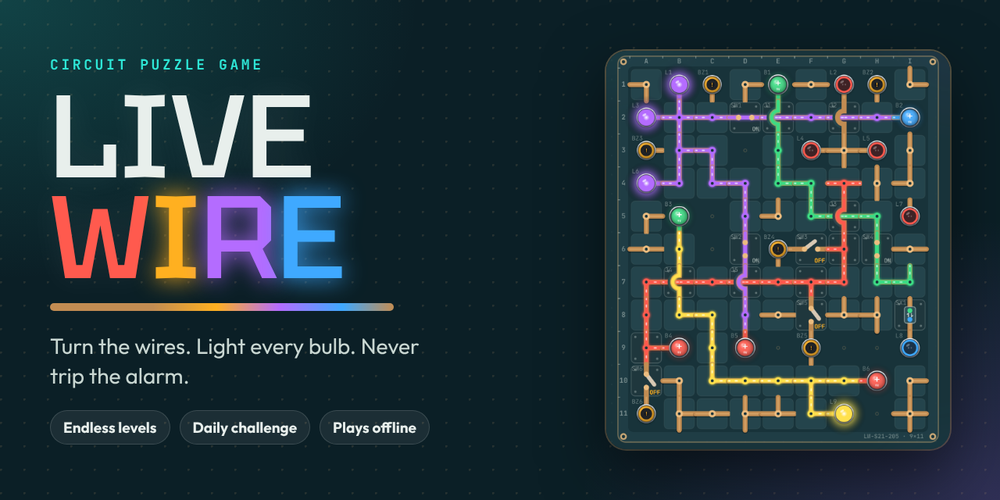
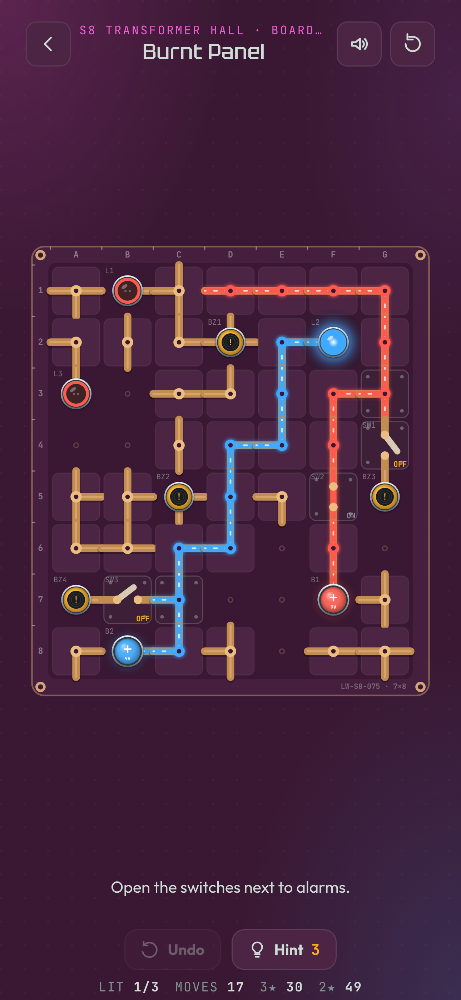
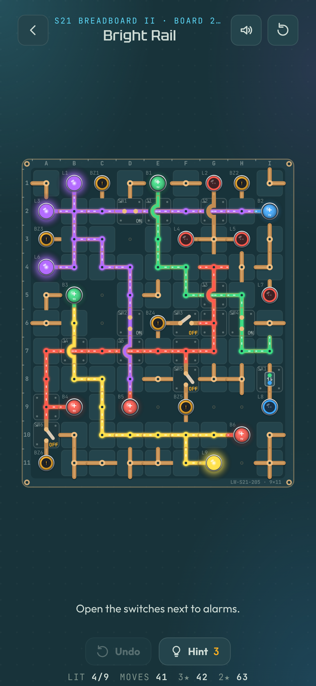
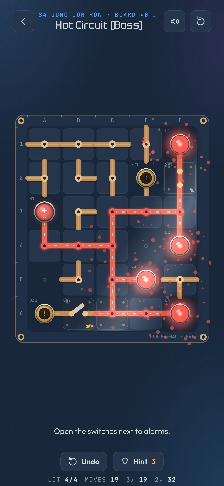
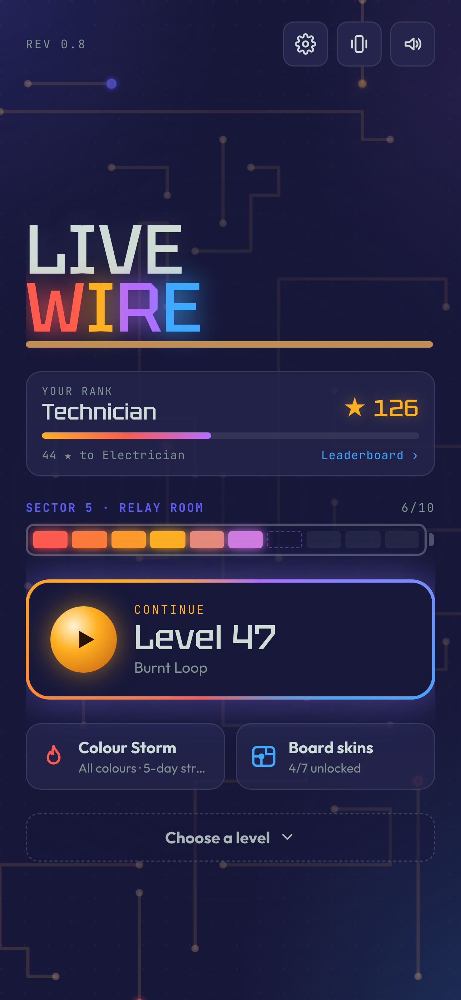

# Live Wire

A circuit puzzle game for phones. Tap wires to turn them, flip switches, and route
power from batteries to bulbs without tripping the alarms.

  
  
  
  

The whole game is one file, `index.html`. It runs offline in any modern browser,
with no build step and no server.

## Play it

- Open `index.html` in a browser, or
- Turn on GitHub Pages for this repository (Settings → Pages → deploy from the `main`
  branch) and open the address it gives you on your phone. In Safari, tap Share →
  Add to Home Screen to play it full-screen like an app.

## What's in the game

- **Endless levels.** Every board is generated from its level number, so level 57
  is the same board on every device. Hand-made teaching boards open each sector
  that introduces a new part.
- **Every board is beatable.** Boards start from a finished, working circuit and are
  then shuffled, so a solution always exists.
- **Learn something new every 10 levels.** Alarms at 11, switches at 21, blue power
  at 31, purple mixing at 41, bridges at 51, diodes at 61, green power at 71, relays
  at 81 and swappers at 91. Boards stay modest while you learn; they only grow once
  you've met every part (level 101 on).
- **Bosses.** Each sector of 10 builds up to a mini-boss at board 5 and a boss at
  board 10. Difficulty is measured in real moves, so neighbouring boards stay close.
- **Pieces:** wires, bolted wires, switches, bridges, alarms (buzzers), batteries in
  red, blue and green, bulbs that need an exact colour mix, swappers that change the
  current's colour (one colour at a time; mixed current stops at a swapper), diodes that only let current flow one way, and relays that close
  when their coil on another circuit gets power. Batteries, bulbs, alarms and coils
  connect only through their pins.
- **Daily challenge.** One board for everyone in the world each day (UTC), in one of
  five types: Overload, Perfect Wiring, Against the Clock, Steady Hands and Colour
  Storm. Daily boards are dense, late-game puzzles (the hardest of several candidates),
  and each one is checked to be beatable under its own rules.
- **Progress:** stars, nine ranks, daily streaks with streak freezes, board skins and
  sector colours that change as you advance.
- **Timed mode (optional).** Off by default, so the normal game stays calm. Turn it on
  to race a stopwatch on every board; beat the gold time for a ⚡ and climb the speed
  leaderboard.
- **Share your daily.** After the daily challenge, share a spoiler-free result card
  (moves, time, tries, streak) as text.
- **Collection.** Unlock little worlds for your board (Swamp, Tide Pool, Firefly Meadow, First Snow, Blossom,
  Starlight), each with its own colours, charms on the bulbs and things drifting by. Board colours too.
- **Rewards:** star chests every 30 stars (hints and streak freezes), a perfect streak
  that earns a hint every 5 three-star boards, combo pop-ups when one tap lights
  several bulbs, and confetti for rank-ups, sector clears and daily wins.
- **Your progress follows you.** Opened from its claude.ai link while signed in, the game saves levels,
  stars, streaks and stats to your account automatically. Anywhere else, Settings → Backup code gives you a
  code to copy and restore on any device. Saves are merged, so restoring never loses progress.
- **Pause menu** with quick settings; the board blurs and every clock stops.
- **Ambient music**, synthesised like the sound effects, with its own on/off switch.
- **Help when stuck:** undo, hints, a tap guide on the first boards, and a free hint
  after three restarts.
- **Feel:** synthesised sound for every action (no audio files), current that flows
  and drains visibly, a power-cut transition between screens, and an energy surge
  when you finish a board.
- **Accessibility:** colour symbols for colour-blind play, and reduced motion is
  respected.
- **Portrait only, iPhone to iPad.** The interface scales up on tablets so an iPad
  feels like a big phone. Held sideways, a phone or tablet shows a "turn your device
  upright" screen and timed challenges pause until it's upright again.

## How the code is organised

Everything lives in `index.html`:

- The block between `/*CORE-START*/` and `/*CORE-END*/` holds the game logic: level
  data, the seeded level generator, current flow, scrambling and the solver used to
  check daily challenges. It has no dependence on the page, so it can be tested in
  Node.
- The rest is the interface: menus, drawing on a canvas, sound and haptics.

## Images and icons

| File | Size | What it's for |
|---|---|---|
| `assets/icons/icon-1024.png` | 1024×1024 | App Store and Google Play icon (no transparency, as both stores require) |
| `assets/icons/icon-512.png`, `icon-192.png` | 512, 192 | Home-screen icons for the web version |
| `assets/icons/icon-maskable-512.png` | 512×512 | Android adaptive icon with a safe margin |
| `assets/icons/apple-touch-icon.png` | 180×180 | iPhone "Add to Home Screen" icon |
| `assets/icons/favicon.ico`, `favicon-32.png` | 16–48 | Browser tab icon |
| `assets/social-preview.png` | 1280×640 | GitHub social preview (Settings → Social preview) and link previews |
| `assets/screenshots/*.png` | 1290×2796 | Raw in-game screenshots at iPhone 6.7" App Store size |
| `assets/store/*.png` | 1290×2796 | Captioned App Store screenshots, ready to upload |

`manifest.webmanifest` lets phones install the web version like an app.

The marketing images use Tektur and Outfit in place of the game's Chakra Petch and
Lexend, which weren't available when they were rendered. Regenerate them from the
game if you want an exact match.

## Important rule for changes

Levels and daily challenges are generated from seeds. If the generator changes,
every player's boards change and saved progress no longer matches. Treat the
generator as locked; add a new generator version for new levels instead of editing
the old one.

## Notes

- The shared leaderboard and daily results only work when the game is opened from
  its claude.ai link. Everywhere else the game works fully, just without the
  leaderboard.
- Vibration works on Android browsers. iPhone browsers don't allow it; the native
  app build will use the phone's haptics instead.

## Next steps

Turn it into a native iOS and Android app with Capacitor. See `CLAUDE.md`.
